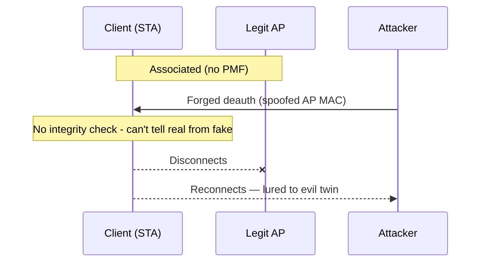
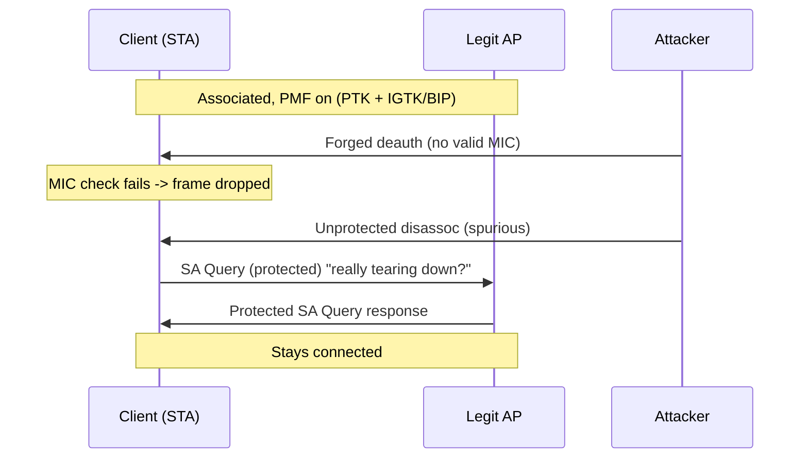
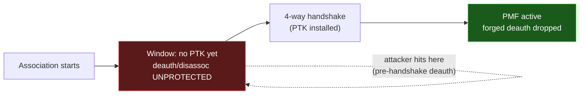
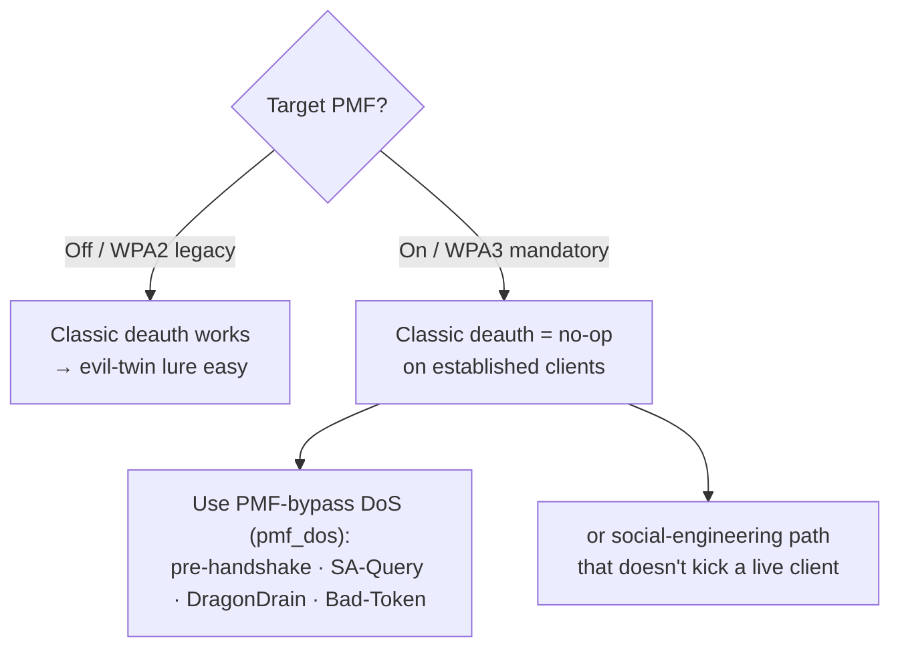

# Why deauth works without PMF but not with it

A short, practical reference on the single setting that decides whether a classic
deauthentication attack works on a WPA2/WPA3 network: **Protected Management
Frames (PMF / IEEE 802.11w)**. This is the branch Airsniffer's target analysis
checks before any deauth-based step, and the reason the `pmf_dos` plugin exists.

## The root cause

Deauthentication and disassociation are **management frames**, not data frames.
In the original 802.11 design, management frames are sent **in the clear, with no
authentication and no integrity check**. Anyone who can hear the network can
forge one.

A deauth attack is just that: the attacker **spoofs the AP's MAC address** and
injects a deauth frame at the client (or vice-versa). Without protection, the
receiver has no way to tell a forged frame from a genuine one, so it disconnects.

PMF (802.11w) adds cryptographic protection to these "robust" management frames.
A forged frame then fails the integrity check and is dropped.

## Diagrams

**Without PMF — forged deauth succeeds:**

**With PMF — forged deauth dropped, SA Query protects:**

**The gap PMF does not cover — pre-handshake window:**

**Operator decision flow:**

## Frame-by-frame comparison

| Frame / case | WPA2 **without PMF** | WPA2/WPA3 **with PMF** |
|---|---|---|
| Unicast deauth / disassoc | Accepted (no check) → **disconnect** | PTK-protected (CCMP MIC); forged = bad MIC → **dropped** |
| Broadcast deauth | Accepted → **disconnect** | BIP-protected (IGTK + MMIE MIC); forged → **dropped** |
| Spurious unprotected deauth to an associated STA | — (no PMF) | Triggers **SA Query**, not an immediate disconnect |
| Beacon / probe (pre-association) | Unprotected | Still unprotected (PMF can't protect pre-key frames) |

## Keys involved (why the attacker can't forge a valid one)

| What protects it | Key | Scope |
|---|---|---|
| Unicast robust mgmt frames | **PTK** (per-client, from the 4-way handshake) | one client |
| Broadcast/multicast robust mgmt frames | **IGTK** via **BIP** (adds an MMIE integrity field) | whole BSS |

The attacker never has the PTK or IGTK, so it cannot compute a valid MIC for a
protected deauth. That is the whole difference.

## The SA Query mechanism

With PMF, if a station that holds a valid security association receives an
**unprotected** deauth/disassoc (which a real, still-associated peer would never
send), it does not disconnect. Instead it starts an **SA Query**: it asks the AP,
over a protected channel, "are you really tearing this down?" If no protected
answer comes, the spurious frame is ignored. This defeats naive deauth floods.

## The catch PMF does NOT cover (what `pmf_dos` targets)

PMF only protects frames **after** the 4-way handshake installs the PTK. That
leaves real gaps, all **PMF-resistant**:

- **Pre-handshake deauth** — while a client is (re)associating, before the PTK
  exists, deauth/disassoc are not yet protected, so they still land. Hit the
  association window instead of an established link.
- **SA-Query inconsistencies** (Schepers, Ranganathan, Vanhoef, WiSec 2022) — the
  spec's handling of unprotected frames is inconsistent across stacks; some can be
  made to disconnect or be flooded.
- **DragonDrain** (Vanhoef & Ronen 2019) — flood WPA3-SAE Commit frames to exhaust
  the AP's CPU. No deauth at all, so PMF is irrelevant.
- **Bad-Token** (Lounis & Zulkernine 2019) — SAE anti-clogging token abuse.

Airsniffer: the classic DoS menu warns when the target has PMF; the **PMF-bypass
DoS** plugin (`plugins/pmf_dos.sh` + `pmf_dos_engine.py`) runs the four strategies
above, with simulate and live modes.

## Operator takeaways

- **Check PMF first.** It decides whether deauth-to-reconnect (the whole
  evil-twin lure) is even viable. PMF is optional in WPA2 and **mandatory in
  WPA3**, so assume WPA3 targets are PMF-protected.
- **PMF off** (common on older WPA2): classic deauth works; evil-twin lure is easy.
- **PMF on**: classic deauth is a no-op on established clients — pivot to
  pre-handshake deauth, SAE DoS, or a social-engineering path that does not rely
  on kicking an already-connected client.
- **Defenders:** enable PMF **mandatory**, drop WPA2/WPA3 transition mode, and keep
  firmware patched (SA-Query and SAE-DoS fixes).

## References

- Schepers, Ranganathan, Vanhoef — *On the robustness of Wi-Fi deauthentication
  countermeasures* (WiSec 2022).
- Vanhoef & Ronen — *Dragonblood: Analyzing the Dragonfly Handshake of WPA3 and
  EAP-pwd* (IEEE S&P 2020); DragonDrain DoS.
- Lounis & Zulkernine — *Bad-Token: Denial of Service attacks on WPA3* (2019).
- IEEE 802.11w — Protected Management Frames (BIP, SA Query).
